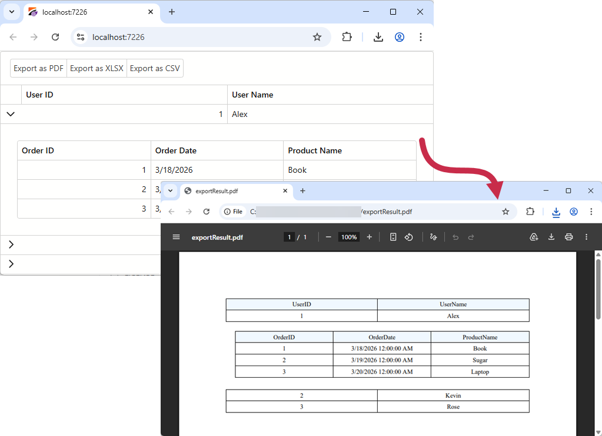

<!-- default badges list -->

[](https://supportcenter.devexpress.com/ticket/details/T1316827)
[](https://docs.devexpress.com/GeneralInformation/403183)
[](#does-this-example-address-your-development-requirementsobjectives)
<!-- default badges end -->
# Blazor Grid - Export Detail Views

The [DevExpress Blazor Grid](https://docs.devexpress.com/Blazor/403143/components/grid) allows you to [export](https://docs.devexpress.com/Blazor/404338/components/grid/export) master view data to multiple formats: PDF, CSV, XLS, and XLSX. This example extends built-in functionality and exports detail views to the resulting document using [DevExpress Reports](https://www.devexpress.com/subscriptions/reporting/web/).



## Implementation Details

To set up a grid with a master-detail layout, specify a [DetailRowTemplate](https://docs.devexpress.com/Blazor/DevExpress.Blazor.DxGrid.DetailRowTemplate#master-detail-grid). Note that the built-in export engine exports master view data only: column captions and data cell values. Export excludes template content. To export detail data, create an intermediate master-detail report and export that report to required format.

### Collect Row Information

1. Create visible column collections for master and detail grids. Use the [GetVisibleColumns](https://docs.devexpress.com/Blazor/DevExpress.Blazor.DxGrid.GetVisibleColumns) method:

    ```charp
    private static string[] GetVisibleColumnNames(IGrid? grid) {
        return grid?.GetVisibleColumns()
                    .OfType<DxGridDataColumn>()
                    .Select(c => c.FieldName ?? c.Name).ToArray() ?? [];
    }
    ```

1. Iterate through all master rows and determine which of them are expanded ([IsDetailRowExpanded](https://docs.devexpress.com/Blazor/DevExpress.Blazor.DxGrid.IsDetailRowExpanded(System.Int32)) is `true`).

    ```csharp
    private Dictionary<string, bool> GetRowsExpandedStates() {
        Dictionary<string, bool> masterRowExpandedStates = new();
        for(int i = 0; i < MasterGrid?.GetVisibleRowCount(); i++) {
            if(MasterGrid.GetDataItem(i) is User user) {
                masterRowExpandedStates[user.UserID.ToString()]
                    = MasterGrid.IsDetailRowExpanded(i);
            }
        }
        return masterRowExpandedStates;
    }
    ```

1. Pass all previously collected information to the method that generates a report:

    ```csharp
    public DxGrid? MasterGrid { get; set; }
    public DxGrid? DetailGrid { get; set; }

    private XtraReport GetReport() {
        return ReportGenerationHelpers.GetReportFromDxGrid(
            GetVisibleColumnNames(MasterGrid),
            GetVisibleColumnNames(DetailGrid),
            GetRowsExpandedStates()
        );
    }
    ```

### Generate a Report

1. Declare a method that accepts grid layout information. [Create a report](https://docs.devexpress.com/XtraReports/115726/feature-guide-to-devexpress-reports/reporting-api/create-reports-in-code) and [bind it to data](https://docs.devexpress.com/XtraReports/15034/feature-guide-to-devexpress-reports/bind-reports-to-data#data-source-types-runtime). [Customize report appearance](./CS/GridMasterDetailExport/Reports/ReportGenerationHelpers.cs#L22) as your needs dictate.

    ```csharp
    public static XtraReport GetReportFromDxGrid(string[] masterColumnNames, string[] detailColumnNames, Dictionary<string, bool> rowExpandedStates) {
        XtraReport report = new XtraReport() {
            ReportUnit = ReportUnit.HundredthsOfAnInch,
            PaperKind = DXPaperKind.Letter,
            Margins = new DXMargins(100, 100, 100, 100)
        };
        // ...
        return report;
    }
    ```

    Refer to the following file to review the full implementation: [ReportGenerationHelpers.cs](./CS/GridMasterDetailExport/Reports/ReportGenerationHelpers.cs).

### Download the Resulting Document

1. Implement a [JavaScript function](./CS/GridMasterDetailExport/wwwroot/scripts/DownloadHelper.js) that initiates file download:

    ```js
    async function downloadFileFromStream(fileName, contentStreamReference) {
        const arrayBuffer = await contentStreamReference.arrayBuffer();
        const blob = new Blob([arrayBuffer]);
        const url = URL.createObjectURL(blob);
        const anchorElement = document.createElement('a');
        anchorElement.href = url;
        anchorElement.download = fileName ?? '';
        anchorElement.click();
        anchorElement.remove();
        URL.revokeObjectURL(url);
    }
    ```

1. Instead of calling the grid's `ExportToCsvAsync`/`ExportToXlsxAsync`/`ExportToPdfAsync` method, call the JavaScript function to download the exported file:

    ```csharp
    private async Task ExportToPdf() {
        using var report = GetReport();
        using var stream = new MemoryStream();
        await report.ExportToPdfAsync(stream);
        await DownloadStreamAsync(stream, "exportResult.pdf");
    }
    async Task DownloadStreamAsync(Stream stream, string fileName) {
        stream.Seek(0, SeekOrigin.Begin);
        using var streamRef = new DotNetStreamReference(stream);
        await JS.InvokeVoidAsync("downloadFileFromStream", fileName, streamRef);
    }
    ```

## Files to Review

- [Index.razor](./CS/GridMasterDetailExport/Components/Pages/Index.razor)
- [ReportGenerationHelpers.cs](./CS/GridMasterDetailExport/Reports/ReportGenerationHelpers.cs)
- [DownloadHelper.js](./CS/GridMasterDetailExport/wwwroot/scripts/DownloadHelper.js)

## Documentation

- [Export Data in Blazor Grid](https://docs.devexpress.com/Blazor/404338/components/grid/export)
- [Export Reports](https://docs.devexpress.com/XtraReports/1302/feature-guide-to-devexpress-reports/store-and-distribute-reports/export-reports)

## More Examples

- [Blazor Grid - Export Images/Rich Text Using Spreadsheet Document APIs](https://github.com/DevExpress-Examples/blazor-grid-export-images-and-rich-text-using-office-file-api)
- [Blazor Grid - How to Export Data to DOCX, HTML, and MHT formats in a server application](https://github.com/DevExpress-Examples/blazor-server-grid-export)
- [Blazor Grid - How to Export Data to DOCX, HTML, and MHT formats in a WebAssembly application](https://github.com/DevExpress-Examples/blazor-webassembly-grid-export)

<!-- feedback -->
## Does This Example Address Your Development Requirements/Objectives?

[](https://www.devexpress.com/support/examples/survey.xml?utm_source=github&utm_campaign=draft-blazor-grid-master-detail-export&~~~was_helpful=yes) [](https://www.devexpress.com/support/examples/survey.xml?utm_source=github&utm_campaign=draft-blazor-grid-master-detail-export&~~~was_helpful=no)

(you will be redirected to DevExpress.com to submit your response)
<!-- feedback end -->
